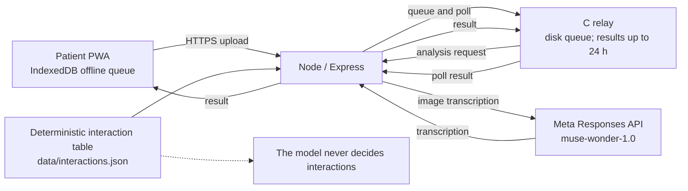

# PharmaClear

PharmaClear reads a photographed prescription, shows what it is sure about, flags what it is not sure about, and checks documented interactions — with the uncertainty always visible.

## Try it in 60 seconds

URL: `<DEPLOY_URL>` · Demo code: `<DEMO_CODE>`

1. Open the URL and enter the demo code.
2. Choose English, French, or Fon.
3. Select **Try a sample prescription** or take a photo.
4. Review the three result areas: read with confidence, uncertain, and interaction alerts.

First load may take about a minute if the free server was asleep. When offline, a photo is queued on the device and analysis resumes when the network returns. Analysis itself requires a network connection.

The sample uses the fictional [prescription image](./public/samples/sample-prescription.png).

## What it does

- Transcribes medicine names and visible dosage instructions, displays the model's confidence, and separates uncertain names.
- Checks medicine pairs against a deterministic, sourced interaction table. AI-suggested interactions, when available, are shown separately and labelled not verified.
- Provides English, French, and Fon interface choices; queues photos for later upload while offline.
- Keeps the submitted photo available in the result view for enlargement, and offers a browser print dialog for saving a result as PDF.

PharmaClear does not recommend a treatment or dosage, does not say that a combination is safe, and is not a medical device.

## Results

The tables below reproduce the latest [evaluation report](./eval/results.md), including both comparison modes.

| Case | Expected | Detected | Uncertain | Strict | Tolerant |
|---|---|---|---|---|---|
| sample-ibuprofen-aspirin | Ibuprofène, Aspirine | Ibuprofène, Aspirine |  | CORRECT | CORRECT |
| 01 | Curacné, Azix, Aclin gel | Curacné, Azix, Aclin gel |  | CORRECT | CORRECT |
| 02 | Paracetamol, Fervex, Arzi | Paracetamol | Fervex, Angi | UNCERTAIN | UNCERTAIN |
| 03 | Antiangineux, Hypotenseur | Antiangineux, Hypotenseur |  | CORRECT | CORRECT |
| 04 | Urée, Glycerine, Acide lactique, Codexial Cold Cream | Urée, Acide lactique | Glycérine, Codexial Cold cream | UNCERTAIN | UNCERTAIN |
| 05 | Baume Saint Bernard, Niflugel | Baume Saint Bernard, Niflugel | Bandes Velpeau | CORRECT | CORRECT |

| Latest-run summary | Value |
|---|---:|
| Transcribed cases | 6 |
| Unlabeled cases | 9 |
| Expected names (denominator) | 16 |
| Strict correct | 12/16 (75.0%) |
| Tolerant correct | 12/16 (75.0%) |
| Uncertain | 3 |
| False-confident | 0 |
| Missed | 1 |
| Errors | 0 |
| Mean time | 6.6 s |

Across the two runs, the observed range was 12–13 names read correctly out of 16, 2–3 uncertain names, 1 missed name, and 0 false-confident names. The latest run also included 9 unlabeled images; descriptively, it returned 8 names read with confidence and 22 uncertain names across those images. Those unlabeled-image counts are not accuracy scores.

Small sample; the model's self-reported confidence is not calibrated. Reproduce with `node eval/run-eval.js`.

## Architecture



The C relay queues uploads and forwards them to Node for analysis. The interaction table is evaluated separately from image transcription; model-generated Level 2 suggestions are never treated as documented table entries.

## Safety & privacy

- Node removes its temporary upload after request handling. The C relay removes the queued photo after a result is received; while processing is pending, the relay retains the queued file for retries. The browser's offline queue holds a photo until upload succeeds, and the result-view photo is kept only in memory while that view is open.
- Relay results are retained for up to 24 hours, then cleaned up.
- The five documented interaction pairs come from a [DailyMed ibuprofen label](https://dailymed.nlm.nih.gov/dailymed/drugInfo.cfm?setid=a266a3c6-932f-476f-ae93-48a785c92286), revised October 2025. The table has not been reviewed by a pharmacist. If a pair is not covered, it is shown as not verified, never as safe.
- Severity labels (`avoid`, `caution`, and `monitor`) are documented editorial categories, not a clinically validated scale.
- Tests and the included sample use fictional prescription images; no real patient photos are included.
- Limits default to 20 requests per minute per client IP and 100 completed analyses per UTC day (`DAILY_ANALYSIS_LIMIT`). The quota counter is stored in `runtime/`; it resets if the host's ephemeral filesystem is replaced or the instance restarts.

## Languages

The interface defaults to English and also offers French and Fon. Fon interface text and the five documented-interaction summaries were written by a Fon speaker and are labelled **“Written by a Fon speaker.”** Automatic translation is only a labelled fallback and can be disabled with `FON_MT=0`.

## Known limits

- Confidence is self-reported by the model and is not calibrated.
- Results varied between the two observed runs by one name out of 16.
- Evaluation uses a small sample: 6 transcribed prescriptions.
- The documented interaction table contains only 5 pairs and uses French generic names; brand names and English names are not recognized by the table.
- A pharmacist has not reviewed the table; severity labels are documented editorial choices.
- Difficult handwriting may be reported as uncertain rather than resolved.
- Level 2 interactions are generated by the model and not verified.
- The free hosting tier sleeps after 15 minutes without traffic, may take about one minute to wake, and its daily counter resets when the instance restarts.
- The prototype has not been clinically validated.

## Run locally / Deploy

Requirements: Node.js 18+, npm, GCC, pthreads, and `curl`.

1. Copy `.env.example` to `.env`. Add `META_API_KEY` or `MODEL_API_KEY` locally only if using the live API. Do not commit `.env`.
2. From the project root, install dependencies and start Node:

   ```sh
   npm install
   npm run dev
   ```

3. In a second terminal, compile and start the C relay:

   ```sh
   cd serveur_c
   gcc -Wall -Wextra -O2 -pthread -o serveur serveur.c
   PHARMA_BIND=127.0.0.1 ./serveur
   ```

4. Open `http://localhost:3000`. Node proxies relay traffic to the C service on port 8080.

Without an API key the server runs in simulation mode; set `PHARMA_MOCK=1` to make that mode explicit. See [DEPLOY.md](./DEPLOY.md) for container and hosting configuration. This project is distributed under the [MIT License](./LICENSE). No hosting provider or public demo URL is configured in this repository.

## Evaluation

Place fictional case images in the Git-ignored `eval/images/` directory, then run `node eval/run-eval.js`. The script writes the report to [`eval/results.md`](./eval/results.md). The indicative API cost is approximately $0.02 per image. See [eval/README.md](./eval/README.md) for the ground-truth format and options.
